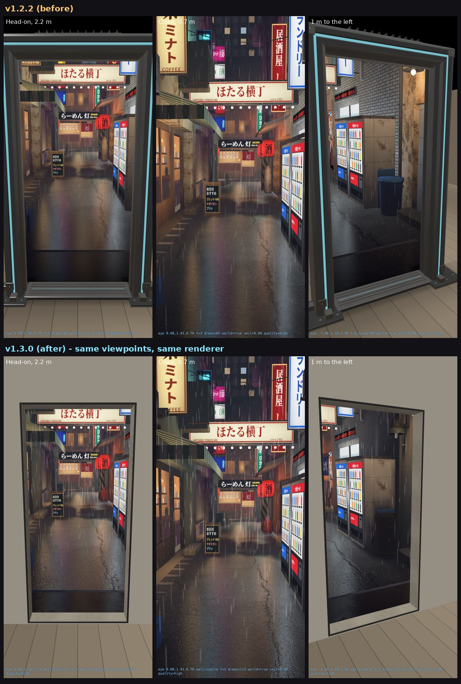

# PortalAlley 1.3.0 (build 6): realism and universal placement

Branch `feature/v1.3.0`, built on 1.2.2. Not merged: it waits for your review on the phone.

## Rollback

| Version | Where | IPA |
|---|---|---|
| 1.2.2 (build 5) | branch `fix/v1.2.2-easy-placement`, PR #5 | artifact of that PR's last green run |
| 1.2.1 (build 4) | branch `fix/fresh-wall-scan-recovery`, PR #4 | artifact of that PR's last green run |

To roll back, sideload the older IPA over 1.3.0 with Sideloadly (same bundle id, it overwrites in place).

## 1. Why 1.2.2 looked synthetic, and what limited placement

**Look**
- Only three surfaces were photographs (asphalt, one concrete, one plaster). The rest
  (tile, shutters, wood, metal) were procedural textures with a clean, repetitive pattern.
- Every prop was a box or lathe primitive: AC units, meters, bins, gas bottles.
- No shadows or ambient occlusion. Light came from 16 analytic point lights without
  visibility, so nothing was grounded. Props floated, corners didn't darken, and walls were
  lit evenly behind awnings.
- The boundary was a 1.3 m metal doorway with a cyan light channel: a sci-fi object, not a hole.
- The desktop preview ignored normal maps, so even the photographed surfaces looked flatter
  there than on the phone.

**Placement**
- Only vertical surfaces could host a portal. Floors and ceilings fell back to a standing doorway.
- The preview jumped between raycasts, and there was no indicator of where you were aiming.
- After placement you could move the portal but not resize or rotate it.

## 2. What changed

### P1 - photoreal materials and props (CC0, no purchases)
- **11 photographed surface families** are now used, all Poly Haven CC0, listed in `docs/LICENSES.md`:
  - tiled facade, board-formed concrete, layered concrete, painted mortar
  - red weathered plaster, corrugated iron (roller shutters and eaves), dark timber
  - asphalt, kerb and stoop concrete, brick, rust
- **Correct photographed scale.** Each scan shows at its real-world size: the material carries
  a UV multiplier. Brightness is normalised per scan, so one scan can serve several painted
  buildings while keeping its stains and wear.
- **10 scanned props** from Poly Haven's "Hidden Alley" family, converted from glTF by
  `Tools/assetgen/props.py`:
  - outdoor AC units (15, clean and rusted, with alpha-cut grilles)
  - steel bins, LPG cylinders, street cabinets
  - a security floodlight, a bare fluorescent tube, a security camera
  - roller-shutter windows, a braced exhaust duct
- **Baked lighting.**
  - A small C ray tracer (`Tools/assetgen/aobake.c`, BVH, 64 AO rays, 8 soft shadow rays per light)
    bakes per-vertex ambient occlusion and the *visibility of each authored light*. This covers
    288,519 vertices on tessellated surfaces in under 10 s.
  - Result: contact shadows under bins and machines, darkened corners, and shade under awnings
    and eaves. The floodlight now casts a shadow, and the wall lamp only lights below its shade.
  - The data travels in a second UV set via `LowLevelMesh`, which requires iOS 18. On iOS 17 the
    shaders fall back to the 1.2 approximation (render `27_wall_no_bake_ios17`).
- Atmosphere is unchanged on purpose: same rain layers, wet-ground streak reflections, fog and
  signage. References from Chongqing and similar cities informed only the rain and lighting
  treatment. There is no generic purple cyberpunk.

### P2 - universal placement
- **Aiming.** CREATE PORTAL now works on a **wall, the floor or the ceiling**.
  - The surface under the screen centre is classified from its normal and its height relative to
    the camera, with ARKit's plane classification as a tie-breaker.
  - **Sloped surfaces** within 40° snap to the nearest category (45° if ARKit agrees) and say so.
  - Anything else falls back to the **floating** standing doorway, as before.
- **Destination per surface.** The alley always stays upright (gravity-coherent):
  - **Floor:** you look down 7 m onto the street, past cables and signs.
  - **Ceiling:** you look up from just above head height under the arch sign, at signs, wires and sky.
  - Geometry on the room side of a horizontal opening is clipped in the shaders.
  - A closed sky, plus a facade closing the alley's open end, are added for these views.
- **Preview.** It glides between raycast results (position lerp + rotation slerp, display only).
  A small crosshair lies on the surface you are aiming at.
- **Orientation lock.** Once placed, the pose is one ARAnchor. The app never re-orients it;
  ARKit's own corrections still apply and are counted in diagnostics.
- **Controls after placement:**
  - **Reposition**
  - **Adjust:** Resize 50-160 %; Rotate in 15° steps, for openings not standing on the floor
  - **Close Portal**
  - **Restart Scan**, Find Portal, Mute
  - Look inside (wall portals only)

  Resize and rotate change only the opening. The alley keeps real-world scale, so a bigger
  opening shows more of it.
- **Floor safety.** The placement banner says not to step onto a floor portal. While you are
  over it or at its edge (35 cm margin), the instruction line warns "Watch your step".

### P3 - the boundary
- **Default "subtle" style:** the opening is cut *exactly* into the surface.
  - The occluder's hole is the clear opening itself.
  - A 16 mm graphite trim stands 10 mm proud.
  - A 16 cm recessed reveal (the "wall thickness") is lit by the room's own environment light.
  - There is no cyan frame and no black backing.
- The **classic** doorway frame remains available: diagnostics → "Classic doorway frame".
  A floating doorway always uses it, because it has no surface to cut into.
- The perspective is correct for vertical and horizontal openings, because they are real 3D
  apertures (renders 19-26).

### P4 - immersion
Unchanged from 1.2.x:
- Look inside (wall portals)
- The crossing guard, with the veil when the phone gets within ~0.5 m of the opening
- Spatial audio: rain and city bed behind the opening, hum at the aperture

Floor and ceiling portals deliberately don't offer walking through.

## 3. Before / after

Both rows are the same desktop WebGL preview, viewpoints and shading code.

- The "before" row is v1.2.2 with its CI photo import reproduced.
- The "after" row puts the subtle opening in a synthetic wall, which is how it appears on a real wall.
- All 27 validation views are in `docs/validation/`, with the v1.2.2 originals in `docs/validation/before_v1.2.2/`.

**Honest assessment.** In the preview, the alley is clearly more grounded and material-rich than 1.2.2. It
still reads as *high-quality CG, not a photograph*:
- Signage, shop interiors, vending fronts, the awning and the crates are still authored artwork.
- Lighting is analytic (no global illumination or screen-space reflections).
- The preview is not RealityKit, and nothing here was seen on an iPhone.

No claim of photorealism is made from tests or renders. Section 7 lists what a true
photogrammetry leap would take.

## 4. Performance budget and strategy

| | 1.2.2 | 1.3.0 |
|---|---|---|
| Alley triangles | 24.7k | 378k (scanned props 240k; the rest includes tessellation for baking) |
| Alley vertices | 31.4k | 292k (48 B each with baked lighting: 13.4 MB vertex buffer) |
| Texture memory, high tier (upper bound: RGBA8 + mips) | ~95 MB + 3 CI-imported photo families | 186 MB |
| Texture memory, low tier | ~24 MB + imports | 46 MB |
| Bundle assets | 11 MB committed + CI-imported photos | 34.5 MB, all committed (no build-time downloads) |
| Lights per pixel | 16 (low: 10) | unchanged |

**Strategy**
- **Cost mostly scales with pixels.** Fragment cost is dominated by the per-pixel light loop
  over only the pixels inside the opening. The geometry grew 15×, mostly scanned props; on
  A17-class GPUs that should be affordable, but it is the first thing to cut if the phone misses
  budget. Options: simplified LODs for distant AC units, or fewer props in the far chunk.
- **Culling.** Opaque geometry stays in a few chunked entities (near / mid / far / distant / sky /
  back cap) so RealityKit can frustum-cull them.
- **Quality tiers.** High is the default on A17 Pro and newer. Low halves textures, uses 10
  lights and 3 rain layers, and renders at 2× content scale. Serious or critical thermal state
  switches to Low automatically.
- **Budget.** 60 fps (16.7 ms) on an iPhone 15 Pro. The diagnostics panel measures mean, p95 and
  % over budget, memory and thermal state on the device. **None of these numbers has been
  measured yet for 1.3.0**; checks 29-40 below ask for them.

## 5. Validation actually performed

| Check | Result |
|---|---|
| PortalCore unit tests on CI (macOS) | 112 tests, 0 failures. New: 29 universal-placement tests (classification, poses, gravity-coherent destinations, clip, resize/rotate, resolver, floor safety, smoothing), a mesh-pack v2 test, 2 shipped-asset tests (subtle boundary, baked lighting ranges, photo maps) |
| iOS build on CI | Release, device SDK, unsigned: **succeeds** (Swift, Metal shaders, LowLevelMesh path all compile) |
| Asset build | offline, deterministic; occluder invariant asserted (alley max z -0.130 < occluder -0.125) |
| Vendored assets | 97 files, SHA-256 verified against `provenance.json` |
| Desktop WebGL preview | 27 views rendered and inspected (wall/floor/ceiling, subtle/classic, resized/rotated, iOS 17 fallback) |
| On an iPhone | **not done**: no device available to me. Everything AR, RealityKit-specific or performance-related is unverified until you run checks 29-40 |

## 6. Limitations (known)

- **Sloped surfaces.** The opening is levelled to the nearest wall, floor or ceiling, so on a ramp or
  sloped ceiling part of the real surface is in front of the opening plane. The UI says so.
- **Floor and ceiling portals** show fixed spots in the alley (7 m above the street; under the arch
  sign). There is no walking through them.
- **Clip edges.** In floor views, objects crossing the 7 m clip height (one AC unit 3.5 m away) can show a
  cut edge at grazing angles.
- **Baked lighting is for the authored lights only.** The moving car headlights and the room's
  real light don't cast baked shadows. The bake needs iOS 18 (LowLevelMesh); iOS 17 uses the 1.2 look.
- **Reveal colour.** The reveal is a neutral plaster colour, not sampled from your wall.
- **Resize** changes only the aperture. LiDAR "clear area" and volume filters still use the nominal size.
- **Untested paths.** RealityKit specifics I could not run:
  - `discard_fragment` clipping in surface shaders
  - `opacityThreshold` grille cutouts
  - uv1 through `LowLevelMesh`
  - texture orientation on that path

  Each has a phone check below.

## 7. A true photogrammetry leap: free and paid options (nothing purchased)

The remaining gap is authored signage and storefronts, and the lack of a real captured street.
Options, cheapest first:

| Option | Cost | Licence | Notes |
|---|---|---|---|
| More Poly Haven / ambientCG scans | free | CC0 | more props and surfaces in the same pipeline; doesn't fix signage |
| Capture a real alley yourself (phone photogrammetry, e.g. RealityScan / Polycam, or a phone LiDAR scan) | free-ish | yours | the only route to "your" Tokyo alley; needs a visit, permission for shop signs and logos, and cleanup |
| Sketchfab CC-BY street scans (e.g. "Freeman Alley Dataset", 1.1M tris, CC BY) | free | CC BY (attribution) | real photogrammetry, but not Japanese; heavy, needs decimation |
| Fab Standard licence (includes Megascans, per-asset prices) | paid, per asset | usable in any engine | high-end surfaces and props; the free-for-all period ended in 2024 |
| Individual scanned Japanese storefronts on Fab / Sketchfab store (e.g. an Omoide Yokocho restaurant scan, $25) | ~$25 each | store licence | check the "NoAI" flag and licence; WIP quality varies |
| Full "Japanese alley" kits on general marketplaces | hundreds to >$1,000 | **check the licence** | some are *editorial use only* and could not ship in an app |

Tell me which way you want to go. I won't buy or activate anything without your say-so.

## 8. Install (Windows, no Mac)

Unchanged; see [INSTALL_WINDOWS.md](INSTALL_WINDOWS.md).

1. Download the `PortalAlley-unsigned-ipa` artifact from the PR's latest green **Build iOS app**
   run and unzip it.
2. Drag `PortalAlley-unsigned.ipa` into **Sideloadly** and sign with your Apple ID.
3. On the phone: trust the profile under Settings → General → VPN & Device Management, with
   Developer Mode on.

The free signing limits still apply: 7 days, 3 apps.
